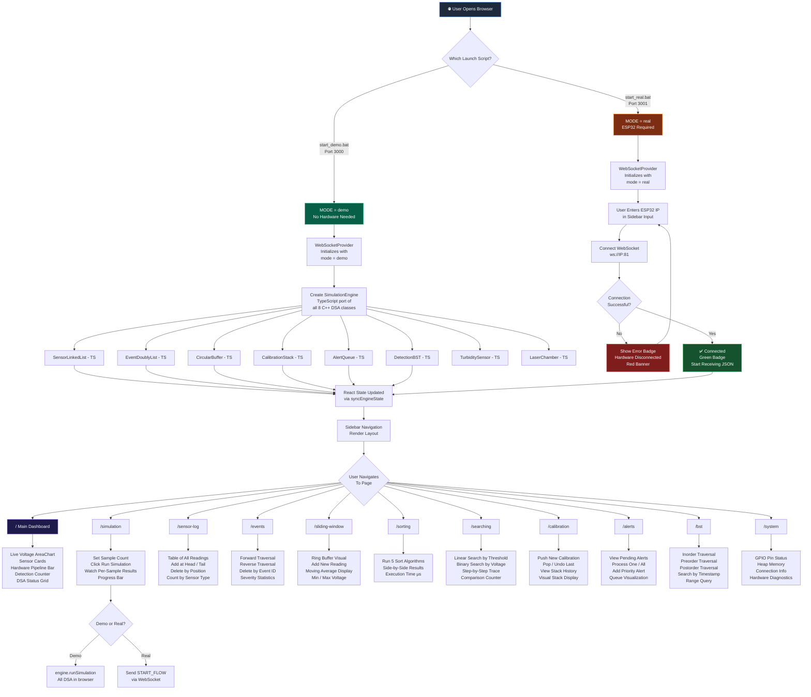
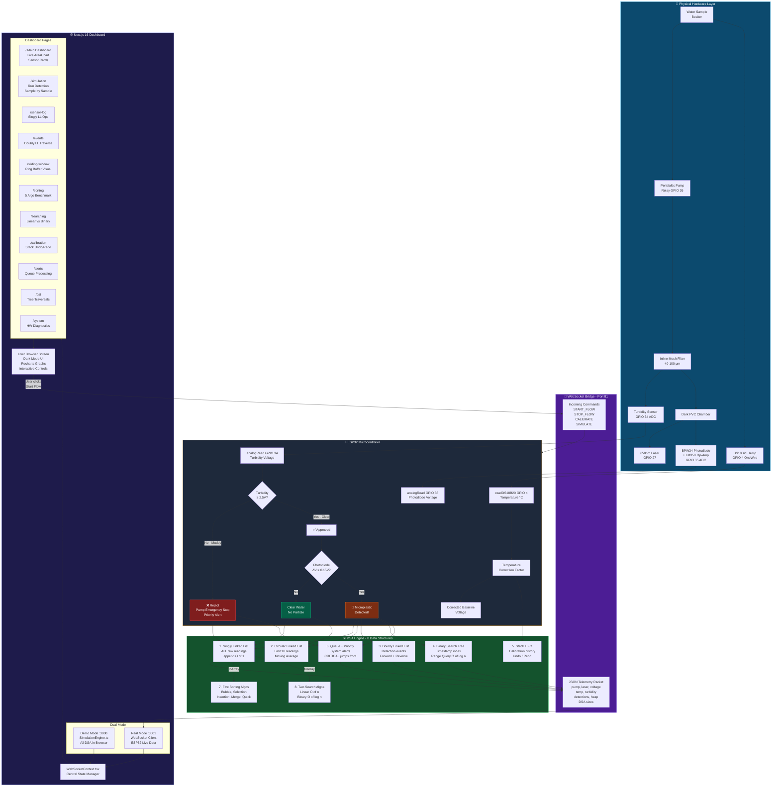

# 🔄 System Flowcharts — Frontend, Backend & Combined

---

## 1. Backend Flowchart (ESP32 Firmware + Desktop C++)

This covers the entire backend pipeline: boot → sensor reads → DSA processing → output.

```mermaid
flowchart TD
    A["🔌 ESP32 Power ON"] --> B["Initialize GPIO Pins\nGPIO 34 Input, GPIO 35 Input\nGPIO 4 Input, GPIO 26 Output\nGPIO 27 Output"]
    B --> C["Connect to WiFi\nSSID + Password"]
    C --> D{"WiFi Connected?"}
    D -->|No| E["Retry Every 500ms\nPrint dots to Serial"]
    E --> D
    D -->|Yes| F["Print IP Address\nStart WebSocket Server\non Port 81"]

    F --> G["Phase 1: Calibration"]
    G --> G1["Read DS18B20 Temp\nGPIO 4 OneWire"]
    G1 --> G2{"DS18B20\nResponded?"}
    G2 -->|Yes| G3["Use Digital Temp\ne.g. 24.5°C"]
    G2 -->|No| G4{"LM35 Analog\nVoltage Valid?\n0.1V - 1.5V"}
    G4 -->|Yes| G5["Use Analog Temp\nV × 100 = °C"]
    G4 -->|No| G6["Default 25.0°C\nBaseline"]
    G3 --> G7["Calculate Correction\nFactor = 1.0 - tempDiff × 0.001"]
    G5 --> G7
    G6 --> G7
    G7 --> G8["Correct Baseline\nbaseline × correctionFactor"]
    G8 --> G9["Push to Calibration\nStack - LIFO"]

    G9 --> H["Phase 2: Activate Hardware"]
    H --> H1["Relay GPIO 26 → HIGH\nPump RUNNING"]
    H1 --> H2["Laser GPIO 27 → HIGH\nLaser ON"]

    H2 --> I["Phase 3: Sample Loop\nFor each water sample"]
    I --> J["Read Turbidity\nanalogRead GPIO 34\nraw / 4095 × 3.3V"]
    J --> K{"Turbidity\nVoltage ≥ 2.5V?"}

    K -->|"No - Muddy Water"| L["❌ REJECT Sample"]
    L --> L1["Create INVALID\nSensorReading"]
    L1 --> L2["Append to Singly\nLinked List"]
    L2 --> L3["enqueuePriority\nCRITICAL Alert\nJumps to Front"]
    L3 --> L4["Emergency Pump\nShutoff - GPIO 26 LOW"]
    L4 --> L5["Broadcast Alert\nvia WebSocket"]
    L5 --> L6["Reset Pump\nRestart Flow"]
    L6 --> I

    K -->|"Yes - Clear Water"| M["✅ Sample Approved"]
    M --> N["Read Photodiode\nanalogRead GPIO 35\nraw / 4095 × 3.3V"]
    N --> O["Create SensorReading\ntimestamp + voltage\n+ PHOTODIODE type"]

    O --> P["1️⃣ Singly Linked List\nsensorLog.append\nO of 1"]
    O --> Q["2️⃣ Circular Buffer\nslidingWindow.insert\nOverwrites oldest if full"]

    Q --> R["Compute ΔV\ndrop = baseline − voltage"]
    R --> S{"ΔV ≥ 0.15V?\nParticle Detected?"}

    S -->|"No - Clear Water"| T["Log: No particle\nUpdate Dashboard"]
    T --> I

    S -->|"Yes - Detection!"| U["Create MicroplasticEvent\nAuto-classify severity"]
    U --> U1{"dropPercent\n> 20%?"}
    U1 -->|Yes| U2["Severity = HIGH"]
    U1 -->|No| U3{"dropPercent\n> 10%?"}
    U3 -->|Yes| U4["Severity = MEDIUM"]
    U3 -->|No| U5["Severity = LOW"]

    U2 --> V["3️⃣ Doubly Linked List\neventHistory.append\nO of 1"]
    U4 --> V
    U5 --> V
    V --> W["4️⃣ Binary Search Tree\ndetectionTree.insert\nKey = timestamp\nO of log n"]
    W --> X["5️⃣ Alert Queue\nalertQueue.enqueue\nFIFO order"]
    X --> Y["Broadcast Detection\nJSON via WebSocket"]
    Y --> I

    I -->|"All Samples Done"| Z["Phase 6: Shutdown"]
    Z --> Z1["Pump STOP\nGPIO 26 → LOW"]
    Z1 --> Z2["Laser OFF\nGPIO 27 → LOW"]
    Z2 --> Z3["Display Final\nDashboard Summary"]

    style A fill:#1e293b,stroke:#3b82f6,color:#fff
    style F fill:#065f46,stroke:#10b981,color:#fff
    style L fill:#7f1d1d,stroke:#ef4444,color:#fff
    style M fill:#14532d,stroke:#22c55e,color:#fff
    style U fill:#7c2d12,stroke:#f97316,color:#fff
    style Z3 fill:#1e1b4b,stroke:#8b5cf6,color:#fff
```

---

## 2. Frontend Flowchart (Next.js Web Dashboard)

This covers the dashboard initialization, mode selection, page routing, and user interactions.

---

## 3. Combined Full-System Flowchart (Hardware → Backend → Frontend)

This shows the complete end-to-end flow from physical water to the user's browser screen.

---

## Quick Reference: What Connects Where

| From | To | Connection | Data Transferred |
|:---|:---|:---|:---|
| Turbidity Sensor | ESP32 GPIO 34 | Analog wire | 0–3.3V ADC voltage |
| Photodiode + LM358 | ESP32 GPIO 35 | Analog wire | 0–3.3V amplified signal |
| DS18B20 Probe | ESP32 GPIO 4 | 1-Wire digital | Temperature in °C |
| ESP32 GPIO 26 | Relay Module | Digital HIGH/LOW | Pump ON/OFF control |
| ESP32 GPIO 27 | Laser Diode | Digital HIGH/LOW | Laser ON/OFF control |
| ESP32 | Dashboard (Real) | WiFi WebSocket :81 | JSON telemetry packets |
| Dashboard (Real) | ESP32 | WiFi WebSocket :81 | Command strings |
| SimulationEngine.ts | Dashboard (Demo) | In-memory JS | Direct function calls |
| Sensor readings | DSA structures | C++/TS pointers | SensorReading objects |
| Detection events | BST + DLL + Queue | C++/TS pointers | MicroplasticEvent objects |
